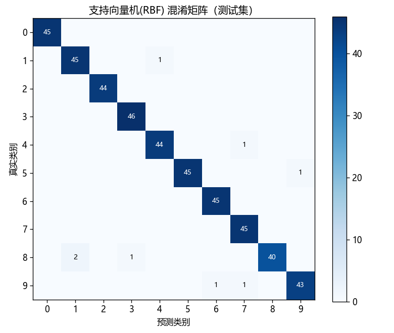
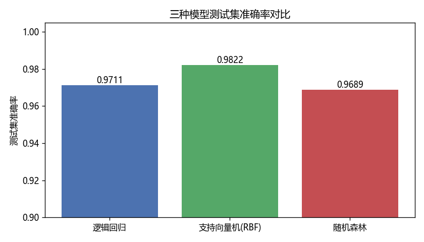

# 神经网络练习

用 PyTorch / scikit-learn 从零实现的机器学习入门项目集合，每个项目记录思路、代码与结果。

## 项目一：MNIST 手写数字识别（CNN，PyTorch）

**目标**：从零实现手写数字识别模型，测试准确率达到 98% 以上。

### 思路

- 模型：两层卷积（32 → 64 通道，3×3 卷积核）+ 2×2 最大池化 + 两层全连接（3136 → 128 → 10）的小型 CNN；
- 预处理：像素归一化到 [0,1]，再用 MNIST 全集统计的均值 0.1307、标准差 0.3081 做标准化；
- 训练：Adam 优化器（lr=1e-3）、交叉熵损失、batch size 128，共 5 个 epoch；
- 正则化：全连接层前加 Dropout(0.25) 防止过拟合。

### 结果

| Epoch | 1 | 2 | 3 | 4 | 5 |
|---|---|---|---|---|---|
| 测试准确率 | 98.33% | 98.59% | 99.01% | 98.91% | **99.09%** |

第 3 个 epoch 即达到 99%+，超过 98% 的目标。训练环境为 CUDA GPU，全程约十几秒。

### 运行方式

```bash
pip install torch torchvision
python mnist_cnn.py
```

首次运行会自动下载 MNIST 数据集（约 11 MB）到 `data/` 目录。

## 项目二：scikit-learn 数字分类对比实验

详见 [评估报告.md](评估报告.md)。

- 代码：[digits_classification.py](digits_classification.py)
- 对多个分类模型进行对比，输出混淆矩阵、错分样本可视化等（见下方图片）。

| 混淆矩阵 | 错分样本 | 模型对比 |
|---|---|---|
|  |  |  |
